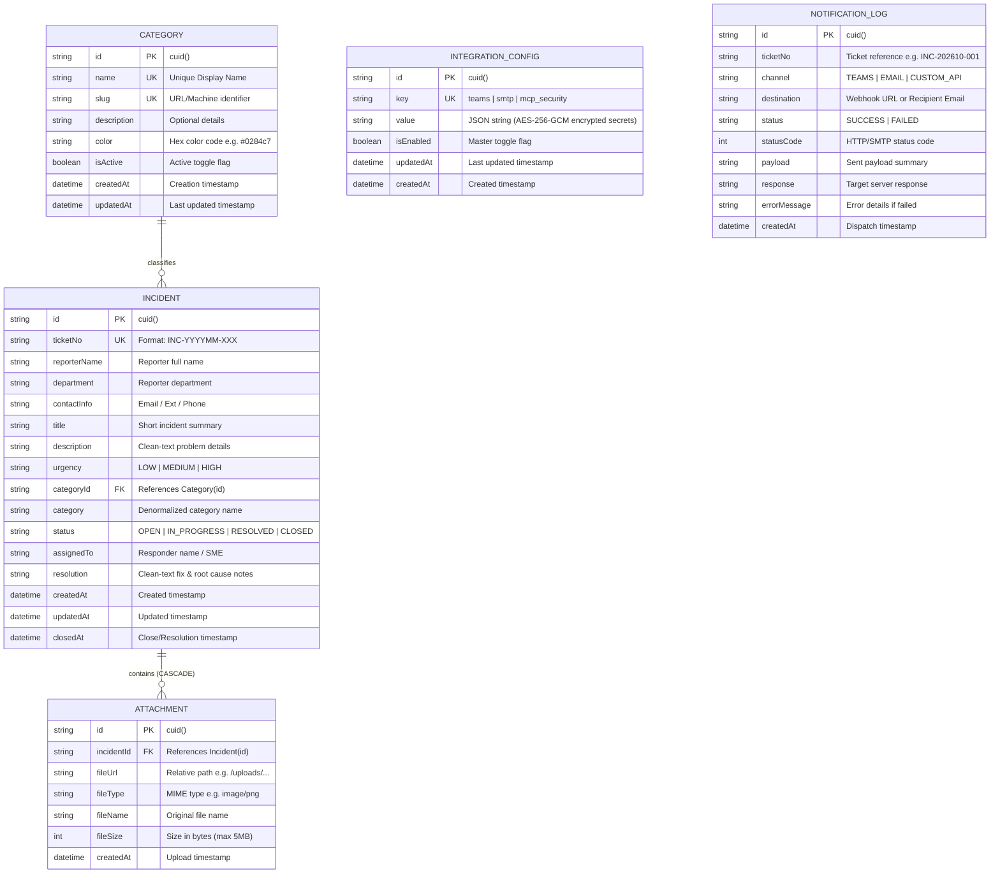

# 📚 Data Dictionary & Schema Specification
## Project: IT Incident Management System (MCP & AI Ready)
**Version:** 1.0  
**Updated:** October 2026  
**Storage Engine:** SQLite 3 (WAL Mode) via Prisma ORM  
**Location:** `./data/incident.db` (Mapped to `/app/data/incident.db` in Docker)

---

## 1. 🗺 Entity-Relationship Diagram (ERD)



---

## 2. 🗄 Database Tables Specification

### 2.1 Table: `Category`
ตารางจัดเก็บหมวดหมู่ของปัญหา (IT Problem Domains) ซึ่งออกแบบให้เป็น **Dynamic Categories** แอดมินสามารถเพิ่ม ลบ หรือแก้ไขได้ตลอดเวลาผ่านหน้า Admin โดยไม่ต้องแก้ไขโค้ด

| Field Name | Type | Nullable | Default | Constraints | Description & Business Rules |
| :--- | :--- | :---: | :---: | :--- | :--- |
| `id` | String | NO | `cuid()` | Primary Key | รหัสเฉพาะประจำ Category (ความยาว ~25-30 ตัวอักษร) |
| `name` | String | NO | - | Unique | ชื่อหมวดหมู่ที่แสดงผล เช่น `SAP Basis`, `Network`, `Helpdesk` |
| `slug` | String | NO | - | Unique | Identifier ภาษาอังกฤษพิมพ์เล็ก เช่น `sap-basis`, `network` |
| `description`| String | YES | `NULL` | - | คำอธิบายขอบเขตของหมวดหมู่เพื่อช่วยในการ Triage |
| `color` | String | YES | `#0284c7` | Hex format | สีประจำหมวดหมู่สำหรับแสดงบน Badge/Pill ใน UI |
| `isActive` | Boolean| NO | `true` | - | สถานะเปิด/ปิดการใช้งาน (`true` = แสดงใน Dropdown) |
| `createdAt`| DateTime| NO | `now()` | - | วันและเวลาที่สร้างหมวดหมู่นี้ |
| `updatedAt`| DateTime| NO | - | Auto-update | วันและเวลาที่มีการแก้ไขข้อมูลล่าสุด |

---

### 2.2 Table: `Incident`
ตารางหลักที่ใช้จัดเก็บข้อมูลคำร้องเรียนและปัญหา IT ทั้งหมด ออกแบบให้รองรับทั้งกระบวนการปฏิบัติงานทั่วไป และรองรับการทำ Data Ingestion สำหรับ MCP (Model Context Protocol) และ Vector Embeddings

| Field Name | Type | Nullable | Default | Constraints | Description & Allowed Values |
| :--- | :--- | :---: | :---: | :--- | :--- |
| `id` | String | NO | `cuid()` | Primary Key | รหัสเฉพาะภายในระบบ (Internal UUID/CUID) |
| `ticketNo` | String | NO | - | Unique, Indexed | **หมายเลข Ticket สาธารณะ** ในรูปแบบ `INC-YYYYMM-XXX`<br>• `YYYYMM`: ปี ค.ศ. และเดือนที่แจ้งเคส เช่น `202610`<br>• `XXX`: Running sequence เริ่มจาก `001` ในแต่ละเดือน |
| `reporterName` | String | NO | - | - | ชื่อ-นามสกุลของผู้แจ้งปัญหา (มาจากฟอร์มหรือ LocalStorage) |
| `department` | String | YES | `NULL` | - | แผนกหรือฝ่ายของผู้แจ้ง เช่น `Finance & Accounting`, `Infra Operations` |
| `contactInfo` | String | NO | - | - | ข้อมูลติดต่อกลับ เช่น อีเมล, เบอร์ต่อภายใน (`Ext. 4412`) |
| `title` | String | NO | - | - | หัวข้อสรุปของปัญหาแบบสั้นกระชับ (Clean Text) |
| `description` | String | NO | - | - | รายละเอียดปัญหา ข้อความ Error ที่พบ (Clean Text ปลอด HTML tags) |
| `urgency` | String | NO | `MEDIUM` | Indexed | ระดับความเร่งด่วนของเคส มี 3 ค่า:<br>• `HIGH`: งานหยุดชะงัก / ระบบหลักล่ม (SLA: 15-30 นาที)<br>• `MEDIUM`: งานติดขัดแต่พอมีทางเลี่ยง (Default)<br>• `LOW`: งานซ่อมทั่วไป / คำถาม / ขอสิทธิ์ |
| `categoryId` | String | YES | `NULL` | Foreign Key | อ้างอิงถึง `Category(id)` สำหรับการ Triage เชิงโครงสร้าง |
| `category` | String | YES | `NULL` | Indexed | Denormalized Category Name เก็บเป็นข้อความไว้เพื่อความรวดเร็วในการ Query และ Filter |
| `status` | String | NO | `OPEN` | Indexed | สถานะการดำเนินงานของ Ticket มี 4 ค่า:<br>• `OPEN`: เคสใหม่ ยังไม่มีผู้รับผิดชอบ<br>• `IN_PROGRESS`: กำลังอยู่ระหว่างการตรวจสอบ/ดำเนินการแก้ไข<br>• `RESOLVED`: ปัญหาได้รับการแก้ไขแล้ว มี Resolution Notes<br>• `CLOSED`: เคสถูกปิดสมบูรณ์ |
| `assignedTo` | String | YES | `NULL` | - | ชื่อเจ้าหน้าที่ IT หรือระบบอัตโนมัติที่รับผิดชอบเคส เช่น `K. Anan`, `MCP Bot (Auto)` |
| `resolution` | String | YES | `NULL` | - | **บันทึกขั้นตอนและวิธีการแก้ไขปัญหา (Root Cause & Fix)**<br>⚠️ สำคัญมากสำหรับ MCP AI ต้องเป็น **Clean Text** (ห้ามใส่สัญลักษณ์ Markdown ซับซ้อน หรือ HTML tags) |
| `createdAt` | DateTime| NO | `now()` | Indexed | วันที่และเวลาที่เปิดเคส (ใช้คำนวณ Ticket Age และ MTTA) |
| `updatedAt` | DateTime| NO | - | Auto-update | วันที่และเวลาที่มีการปรับปรุงข้อมูล Ticket ล่าสุด |
| `closedAt` | DateTime| YES | `NULL` | - | วันที่และเวลาที่เคสเปลี่ยนสถานะเป็น RESOLVED/CLOSED (ใช้คำนวณ MTTR) |

---

### 2.3 Table: `Attachment`
ตารางจัดเก็บไฟล์รูปภาพ Screenshot หรือ Diagnostic Dump ที่แนบมากับ Ticket

| Field Name | Type | Nullable | Default | Constraints | Description & Storage Details |
| :--- | :--- | :---: | :---: | :--- | :--- |
| `id` | String | NO | `cuid()` | Primary Key | รหัสเฉพาะของ Attachment |
| `incidentId`| String | NO | - | Foreign Key | อ้างอิงถึง `Incident(id)` มีเงื่อนไข `ON DELETE CASCADE` (หากลบเคส ไฟล์ที่ผูกไว้จะถูกลบด้วย) |
| `fileUrl` | String | NO | - | - | URL Path สำหรับเข้าถึงไฟล์ เช่น `/uploads/1730894042_sap_dump.png` |
| `fileType` | String | NO | - | - | MIME Type ของไฟล์ เช่น `image/png`, `image/jpeg`, `image/gif` |
| `fileName` | String | YES | `NULL` | - | ชื่อไฟล์เดิมของผู้ใช้งาน |
| `fileSize` | Int | YES | `NULL` | - | ขนาดของไฟล์ในหน่วย Bytes (จำกัดขนาดสูงสุดไม่เกิน 5,242,880 Bytes หรือ 5MB) |
| `createdAt`| DateTime| NO | `now()` | - | วันและเวลาที่อัปโหลดไฟล์ |

---

### 2.4 Table: `IntegrationConfig`
ตารางจัดเก็บการตั้งค่าระบบเชื่อมต่อภายนอกและรหัสความปลอดภัย (ข้อมูลลับ เช่น รหัสผ่าน SMTP, Webhook URL และ API Key ถูกเข้ารหัสด้วย **AES-256-GCM** ในรูปแบบ `enc:v1:<iv>:<authTag>:<cipher>` ก่อนบันทึกเสมอ)

| Field Name | Type | Nullable | Default | Constraints | Description |
| :--- | :--- | :---: | :---: | :--- | :--- |
| `id` | String | NO | `cuid()` | Primary Key | รหัสเฉพาะของรายการตั้งค่า |
| `key` | String | NO | - | Unique | ชื่อหมวดการตั้งค่า: `teams`, `smtp`, `mcp_security` |
| `value` | String | NO | - | JSON String | ข้อมูลคอนฟิกแบบ JSON ที่เข้ารหัสฟิลด์ความลับด้วย AES-256-GCM |
| `isEnabled` | Boolean| NO | `true` | - | สวิตช์เปิด/ปิดการทำงานของโมดูลนั้นๆ |
| `updatedAt` | DateTime| NO | - | Auto-update | วันเวลาที่แก้ไขล่าสุด |
| `createdAt` | DateTime| NO | `now()` | - | วันเวลาที่สร้าง |

---

### 2.5 Table: `NotificationLog`
ตารางบันทึกประวัติการส่งแจ้งเตือนขาออกทุกช่องทาง (Teams Webhook, SMTP Email, Custom Event API) พร้อมรองรับการกดส่งซ้ำ (Resend)

| Field Name | Type | Nullable | Default | Constraints | Description |
| :--- | :--- | :---: | :---: | :--- | :--- |
| `id` | String | NO | `cuid()` | Primary Key | รหัสเฉพาะของ Log |
| `ticketNo` | String | YES | `NULL` | Indexed | หมายเลข Ticket อ้างอิง |
| `channel` | String | NO | - | Indexed | ช่องทาง: `TEAMS`, `EMAIL`, `CUSTOM_API` |
| `destination`| String | NO | - | - | ปลายทาง (Webhook URL หรือรายชื่ออีเมลผู้รับ) |
| `status` | String | NO | - | Indexed | สถานะการส่ง: `SUCCESS`, `FAILED` |
| `statusCode` | Int | YES | `NULL` | - | รหัสตอบกลับ HTTP/SMTP เช่น `200`, `202`, `250`, `500` |
| `payload` | String | YES | `NULL` | - | ข้อมูล JSON หรือสรุปเนื้อหาที่ส่งออก |
| `response` | String | YES | `NULL` | - | ข้อความตอบกลับจากเซิร์ฟเวอร์ปลายทาง |
| `errorMessage`| String | YES | `NULL` | - | รายละเอียดข้อผิดพลาดกรณีส่งไม่สำเร็จ |
| `createdAt` | DateTime| NO | `now()` | Indexed | วันและเวลาที่ส่งแจ้งเตือน |

---

## 3. 🤖 Model Context Protocol (MCP) Data Schema

สำหรับส่งมอบข้อมูลให้ External MCP Client / Autonomous Agent ระบบได้กำหนด Schema มาตรฐานกลาง `mcp.incident.v1` (ไม่ผูกติดกับค่ายหรือยี่ห้อ AI ใดๆ):

```json
{
  "mcp_resource_uri": "mcp://incidenthub/incidents/INC-202610-001",
  "ticketNo": "INC-202610-001",
  "app_domain": "SAP Basis",
  "severity": "P1_CRITICAL",
  "status": "OPEN",
  "vectors_ready": true,
  "clean_text_corpus": "Title: SAP S/4HANA GUI error 'RFC_COMMUNICATION_FAILURE' during Month-End closing Description: Executing batch reconciliation transaction F.05 against company code 1020. Program hung for ~4 minutes before terminating with dump 'RFC_COMMUNICATION_FAILURE'. Network connection verified stable. Affected 4 users in Finance AP. Resolution: Killed hanging job in SM50, restarted RFC connection in SM59, verified connectivity test. Actionable Prevention: Configured RFC buffer limits in SAP profile parameter rfc/max_conn.",
  "ai_remediation_tags": [
    "RFC_TIMEOUT",
    "SM50_WORKPROCESS",
    "SM59_DESTINATION",
    "SAP_BASIS"
  ],
  "reporter_context": {
    "department": "Finance & Accounting",
    "reported_at": "2026-10-26T14:14:22.000Z",
    "closed_at": null
  }
}
```

### 🧹 Clean Text Sanitization Rules:
1. ตัด HTML Tags ทั้งหมด (`<...>` ➔ ถูกแทนที่ด้วยช่องว่าง)
2. ตัด Markdown Links (`[text](url)` ➔ เหลือเพียง `text`)
3. ตัด Formatting Characters (`*`, `#`, `_`, `~`, `` ` ``)
4. ยุบช่องว่างและบรรทัดว่างเกินความจำเป็น (Multiple spaces/newlines ➔ Single space)

---

## 4. 🌐 API Endpoints & Data Contracts

| Method | Endpoint | Request Payload / Params | Response Summary |
| :--- | :--- | :--- | :--- |
| **GET** | `/api/incidents` | `search`, `status`, `urgency`, `category`, `department`, `page`, `limit` | รายการเคสแบบ Paginated พร้อมสถิติ KPI รวม |
| **POST** | `/api/incidents` | `multipart/form-data` หรือ JSON: `reporterName`, `department`, `contactInfo`, `title`, `description`, `urgency`, `attachment` | Incident Object ที่ถูกสร้างใหม่พร้อม Ticket ID |
| **GET** | `/api/incidents/[id]` | `id` หรือ `ticketNo` | รายละเอียดเคสพร้อม Attachments และ Category Relation |
| **PATCH** | `/api/incidents/[id]` | JSON: `{ status?, category?, urgency?, assignedTo?, resolution? }` (รองรับ `x-api-key`) | Incident Object ที่อัปเดตแล้ว |
| **GET** | `/api/incidents/export` | `search`, `status`, `urgency`, `category`, `department`, `startDate`, `endDate` | ไฟล์ `.csv` เข้ารหัส UTF-8 with BOM สำหรับเปิดใน Excel |
| **GET** | `/api/incidents/analytics` | `startDate`, `endDate` | ข้อมูลสรุปกราฟ 4 มิติ (Trend, Category, Department, SLA) |
| **GET** | `/api/categories` | - | รายชื่อ Categories ทั้งหมด เรียงตามชื่อ |
| **POST** | `/api/categories` | JSON: `{ name, description?, color?, slug? }` | Category Object ที่สร้างใหม่ |
| **DELETE**| `/api/categories/[id]` | `id` | `{ success: true }` |
| **GET** | `/api/mcp/v1/context` | `?ticketNo=INC-XXX` (รองรับ Header `x-api-key`) | Clean MCP Schema JSON สำหรับ External MCP Client |
| **GET** | `/api/mcp/v1/insights` | รองรับ Header `x-api-key` | ข้อมูลสรุปภาพรวม KPI, MTTA, MTTR และ Category Load |
| **GET** | `/api/mcp/v1/recurring`| รองรับ Header `x-api-key` | การจัดกลุ่มเคสที่เกิดซ้ำซ้อน (Clustering by Patterns) |
| **POST** | `/api/events/notify` | JSON: `{ detail, urgency, incident_type, webhookUrl? }` (รองรับ `x-api-key`) | ส่งแจ้งเตือนไปยัง Webhook ปลายทางพร้อมบันทึก Log |
| **GET** | `/api/incidents/inbound` | - | ข้อมูล Documentation และตัวอย่าง Payload สำหรับ Inbound Incident API |
| **POST** | `/api/incidents/inbound` | JSON (Smart Mapping): `{ title/summary, description/detail, urgency/severity?, reporterName/sourceSystem?, department?, category? }` (รองรับ `x-api-key`) | รับแจ้ง Incident จากระบบภายนอก (Zabbix, Grafana, ERP) บันทึกลง SQLite ออกเลข Ticket อัตโนมัติ และยิง Teams/Email |
| **GET/PUT/POST** | `/api/integrations` | Admin Session Cookie | ดึง/บันทึกการตั้งค่า Teams, SMTP, MCP Security และหมุนเปลี่ยน API Key |
| **GET/POST** | `/api/integrations/logs` | Admin Session Cookie | ดึงประวัติการส่งแจ้งเตือนและสั่งส่งซ้ำ (Resend) |
| **POST/DELETE/GET** | `/api/auth/admin` | JSON: `{ passcode }` | เข้าสู่ระบบ/ออกจากระบบ Admin Console ด้วย HTTP-Only Signed Cookie |
| **POST** | `/api/teams/ping` | - | ส่ง Test Ping ทดสอบ Webhook |

---

## 5. 💾 Client-Side Storage Dictionary (LocalStorage)

เพื่อให้ผู้ใช้งานในองค์กรสามารถส่งเคสได้อย่างสะดวกรวดเร็วโดยไม่ต้องล็อกอิน ระบบบันทึกข้อมูลประจำตัวของผู้แจ้งลงใน Browser LocalStorage:

| Storage Key | Format | Example Value | Description |
| :--- | :--- | :--- | :--- |
| `incidenthub_reporter_identity` | JSON Object String | `{"reporterName":"Somchai Prasert","department":"Finance & Accounting","contactInfo":"somchai.p@company.com / Ext. 4412"}` | บันทึกชื่อ, แผนก, และเบอร์ติดต่อ โดยผู้ใช้สามารถกดแก้ไข (Edit) หรือล้างข้อมูล (Clear) ได้จากหน้าจอ |

---

## 6. 🛠 คำแนะนำสำหรับการปรับปรุงและแก้ไขในอนาคต (Maintenance Guide)

### เมื่อต้องการเพิ่มฟิลด์ใหม่ลงใน Database:
1. แก้ไขไฟล์ [`prisma/schema.prisma`](file:///d:/Develop/nextjs/Incident/prisma/schema.prisma)
2. รันคำสั่งอัปเดต Schema ลงฐานข้อมูล SQLite:
   ```bash
   npx prisma db push
   ```
3. หากมี Type Interface ใน TypeScript ให้เพิ่มฟิลด์ที่เกี่ยวข้องใน:
   - [`src/lib/services/incident.service.ts`](file:///d:/Develop/nextjs/Incident/src/lib/services/incident.service.ts)
   - หน้าจอ UI Component ที่เกี่ยวข้อง

### เมื่อต้องการขยายความสามารถของระบบ MCP:
- สามารถดึงข้อมูลผ่าน Endpoint `GET /api/mcp/v1/context` (พร้อมแนบ Header `x-api-key` เมื่อเปิดโหมดบังคับใช้ความปลอดภัย) หรือเชื่อมต่อ MCP Server ภายนอกมาอ่านไฟล์ SQLite ที่ `./data/incident.db` โดยตรงได้แบบ Read-Only
- ข้อมูลฟิลด์ `resolution` ถูกออกแบบให้เป็น Clean Text เสมอ จึงสามารถนำไปแปลงเป็น Vector Embeddings ด้วยโมเดลใดก็ได้ทันทีโดยไม่ต้องผ่านกระบวนการ Data Cleaning ซ้ำ
